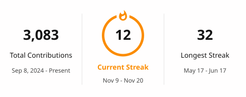

<h1 align="center">김민우</h1>

<strong>Game Client Programmer</strong>

<em>오늘도 "한 판 더"가 무한 루프 도는 게임을 만듭니다.</em>

  
  
  

<h2 align="center">Skills</h2>

  
  
  
  
  

<h2 align="center">Tools</h2>

  
  
  
  
  

<h2 align="center">Stats</h2>

  

  
  

